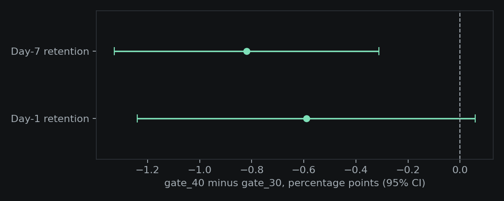

# A/B Test Analysis: did moving the gate hurt retention?

A tested experimentation toolkit and a full analysis of a real public A/B test: the mobile game Cookie Cats moved its first progression gate from level 30 to level 40. 90,189 players were split between the two versions.

**Result:** moving the gate to level 40 **lowered day-7 retention by 0.82 percentage points** (19.02% to 18.20%, 95% CI -1.33 to -0.31, p = 0.0016, survives Holm correction). Day-1 retention moved the same direction but is not significant (p = 0.074). **Recommendation: keep the gate at level 30.**



## What the analysis does
- **Sample-ratio-mismatch check first.** The split is 44,700 vs 45,489 (49.6% / 50.4%), chi-square p = 0.0086. That is below 0.05 but above the usual 0.001 alarm line. Worth flagging to the data owner; I did not treat the result as invalid, and I say so here.
- **Two-proportion z-test** with an absolute-lift confidence interval for both retention metrics.
- **Multiple-testing correction** (Holm) across the two retention metrics.
- **Bayesian check:** P(gate_40 better) is 0.1% for day-7 retention.
- **A/A validation:** randomly splitting the data into fake arms gives 5.0% and 5.4% false positives, so the test is calibrated.
- **Power:** with this sample the minimum detectable day-7 effect is 0.74 pp. Detecting 0.5 pp would need about 97,700 players per arm.
- **Engagement (game rounds)** compared after winsorizing at the 99th percentile (493 rounds; the raw max is 49,854, a likely bot or logging error), with a bootstrap CI (-1.30 to +0.72 rounds, no clear difference) and Mann-Whitney (p = 0.050).

## Limits, stated plainly
- Public dataset, one game, one test. Players were randomly assigned by the game studio; I did not run the experiment.
- No pre-experiment data, so variance reduction such as CUPED is not possible.
- A split by rounds played is post-treatment (rounds can be affected by the gate), so the segment table in `reports/results.json` is descriptive, not causal.
- Retention is binary. Revenue and lifetime value are not in the data.
- The SRM p-value of 0.0086 is a yellow flag, not proof of a broken split.

## Run it
```
pip install -r requirements.txt
python -m pytest -q          # 10 tests
python -m src.analyze        # writes reports/results.json
python -m src.plot           # writes reports/lift.png
```
Data: `data/cookie_cats.csv`, the public Cookie Cats dataset (90,189 rows), originally shared via DataCamp and Kaggle.

## Stack
Python, NumPy, pandas, SciPy, matplotlib, pytest, ruff, GitHub Actions.
