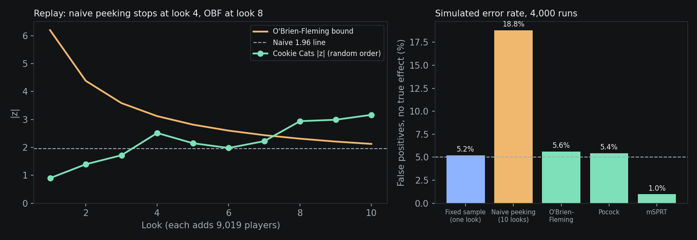

# A/B Test Analysis: did moving the gate hurt retention?

[](https://github.com/VasilenData/ab-test-analysis/actions/workflows/ci.yml)

A tested experimentation toolkit (fixed-sample tests, sequential testing, CUPED) and a full analysis of a real public A/B test: the mobile game Cookie Cats moved its first progression gate from level 30 to level 40. 90,189 players were split between the two versions.

**Result:** moving the gate to level 40 **lowered day-7 retention by 0.82 percentage points** (19.02% to 18.20%, 95% CI -1.33 to -0.31, p = 0.0016, survives Holm correction). Day-1 retention moved the same direction but is not significant (p = 0.074). **Recommendation: keep the gate at level 30.**


## What the analysis does
- **Sample-ratio-mismatch check first.** The split is 44,700 vs 45,489 (49.6% / 50.4%), chi-square p = 0.0086. That is below 0.05 but above the usual 0.001 alarm line. Worth flagging to the data owner; I did not treat the result as invalid, and I say so here.
- **Two-proportion z-test** with an absolute-lift confidence interval for both retention metrics.
- **Multiple-testing correction** (Holm) across the two retention metrics.
- **Bayesian check:** P(gate_40 better) is 0.1% for day-7 retention.
- **A/A validation:** randomly splitting the data into fake arms gives 5.0% and 5.4% false positives, so the test is calibrated.
- **Power:** with this sample the minimum detectable day-7 effect is 0.74 pp. Detecting 0.5 pp would need about 97,700 players per arm.
- **Engagement (game rounds)** compared after winsorizing at the 99th percentile (493 rounds; the raw max is 49,854, a likely bot or logging error), with a bootstrap CI (-1.30 to +0.72 rounds, no clear difference) and Mann-Whitney (p = 0.050).

## Sequential testing: looking early without lying
Peeking at a fixed-sample test inflates false positives. `src/sequential.py` implements Lan-DeMets alpha-spending boundaries (O'Brien-Fleming and Pocock, solved by numerical integration, no external library) and an always-valid mSPRT.



Simulation, 10 looks, 20,000 players per arm at most, baseline 19%, 4,000 runs (`python -m src.simulate`):

| Rule | False positives, no effect | Power, true effect +0.82 pp | Avg. share of sample used before stopping |
|---|---|---|---|
| Fixed sample, one look | 5.2% | 54.1% | 100% |
| Naive peeking at 1.96 | **18.8%** | 66.8% | n/a (invalid) |
| O'Brien-Fleming | 5.6% | 51.6% | 87% |
| Pocock | 5.4% | 42.8% | 83% |
| mSPRT (tau 0.01) | 1.0% | 21.2% | 94% |

- Boundaries are checked by Monte Carlo: 400,000 null paths give overall error 4.96% (OBF, 5 looks) and 4.95% (OBF, 10 looks). The 5-look Pocock value (2.41 to 2.44) matches the textbook constant 2.413.
- The 5.6% OBF figure is within simulation error of 5%; 4,000 runs give about plus or minus 0.35 pp.
- mSPRT is conservative here: it can be stopped at any time, but it pays in power. A different prior width (tau) would shift that trade-off; I used one value and did not tune it.
- **Cookie Cats replay (illustration only).** The data has no timestamps, so I replayed the players in random order. Naive peeking would have declared a winner at look 4 (36,075 players, z = -2.51) and the z-score then drifted back toward 1.98. O'Brien-Fleming stops at look 8 (72,151 players, z = -2.94 vs bound 2.31). The always-valid p-value reaches 0.037 at the final look. Details: `reports/cookie_cats_sequential.json`.

## CUPED: same test, fewer players
`src/cuped.py` adjusts the outcome with a pre-experiment covariate. Simulation, 5,000 players per arm, true effect 0.30, 2,000 runs per row (`reports/cuped.json`):

| Correlation of covariate with outcome | Variance vs. unadjusted | Theory (1 - rho^2) | Mean estimate | 95% CI coverage |
|---|---|---|---|---|
| 0.0 | 1.00 | 1.00 | 0.300 | 96.0% |
| 0.3 | 0.91 | 0.91 | 0.300 | 95.8% |
| 0.5 | 0.75 | 0.75 | 0.300 | 94.7% |
| 0.7 | 0.51 | 0.51 | 0.300 | 95.7% |
| 0.9 | 0.19 | 0.19 | 0.300 | 94.0% |

Estimates stay unbiased and intervals keep their coverage. A covariate measured after assignment breaks this: when the treatment moves the covariate, CUPED returned 0.28 against a total effect of 0.55, a bias of -0.27. The covariate must be pre-experiment.

## Decisions and trade-offs
- **Alpha spending over a fixed look schedule.** Lan-DeMets spending functions let the number and timing of looks vary without breaking the error rate. This implementation assumes equally spaced looks; unequal spacing is a small change to the information fractions and is not built or tested.
- **O'Brien-Fleming as the default boundary.** It spends almost no alpha early, so an early look rarely stops the test on noise, and it ends near the fixed-sample cutoff (2.12 at look 10 vs 1.96). The price in the simulation is about 2.5 points of power against one look at the end (51.6% vs 54.1%). Pocock stops earlier on average but gave 42.8% power.
- **A solver written from scratch instead of a library.** I wrote the boundary solver so I could test it: it must reproduce the textbook Pocock constant and hold 5% error over 400,000 simulated paths. Both checks are in the test suite.
- **mSPRT prior width (tau) not tuned.** One value, 0.01, chosen once. Tuning it to this simulation would flatter the method, so I did not.
- **Frequentist throughout.** The Bayesian check is a sanity number, not a sequential Bayesian design.

## Next steps
Unequal look spacing, a binomial-exact boundary check for small samples, and CUPED on a dataset that has a genuine pre-experiment metric.

## Limits, stated plainly
- Public dataset, one game, one test. Players were randomly assigned by the game studio; I did not run the experiment.
- Cookie Cats has no pre-experiment metric, so CUPED is implemented and validated on simulated data only, not on this dataset.
- A split by rounds played is post-treatment (rounds can be affected by the gate), so the segment table in `reports/results.json` is descriptive, not causal.
- Simulations use idealized normal and binomial data; real metrics with heavy tails or novelty effects will behave less cleanly.
- Retention is binary. Revenue and lifetime value are not in the data.
- The SRM p-value of 0.0086 is a yellow flag, not proof of a broken split.

## Run it
```
pip install -r requirements.txt
python -m pytest -q          # 25 tests
python -m src.analyze        # writes reports/results.json
python -m src.plot           # writes reports/lift.png
python -m src.simulate       # sequential + CUPED studies, about 15 s
python -m src.plot_sequential # writes reports/sequential.png
```
Data: `data/cookie_cats.csv`, the public Cookie Cats dataset (90,189 rows), originally shared via DataCamp and Kaggle.

## Stack
Python, NumPy, pandas, SciPy, matplotlib, pytest, ruff, GitHub Actions.
